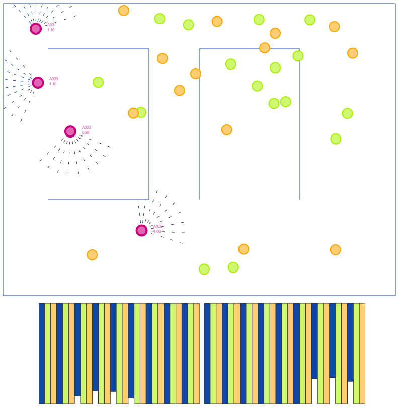

# Multi-Agent DQN on Caffe

> **Status: archived.** This repository is a historical artifact from ~2017 (Caffe + Angular 2 era) and is no longer maintained. It is preserved for reference.

Multi-agent deep Q-learning demo in which the agents run in the browser and a C++ Caffe server performs the learning over Socket.IO. Inspired by Karpathy's [ConvNetJS rldemo](http://cs.stanford.edu/people/karpathy/convnetjs/demo/rldemo.html) and [muupan/dqn-in-the-caffe](https://github.com/muupan/dqn-in-the-caffe).



## What it demonstrates

- **Agents in the browser, learner on the server.** Each Angular front-end agent sends its "eyes" observation to the Caffe server; the server replies with an action. The agent then computes the reward locally and ships the `(state, action, reward, next_state)` transition back. The server accumulates transitions in a replay buffer and trains the DQN in batches when idle.
- **Caffe as an online training backend.** Rather than using Caffe as a batch-training tool, the server wraps it behind a Socket.IO connection so the network can be queried and updated live.
- **Multiple agents sharing a single network.** All browser agents share one policy on the server, interleaving experience collection and training.

## Layout

```
caffe_client/       Angular 2 front end: environment, agents, D3 visualization
caffe_server/       C++ Caffe server with Socket.IO connection handler
  source/             application.h, caffe_network.h, connection.h, main.cpp
  models/             network.prototxt, solver.prototxt, trained-network.bin
screenshot.png
```

## Era and dependencies

The project was built against a fixed snapshot of dependencies that are mostly end-of-life today:

- Caffe (BVLC, Windows branch) at commit `8bb7cbc2162ded85802d61f83b5ac2881f21a7fd`
- CUDA 8, cuDNN v5.1 (optional; the GPU path was not exercised)
- socket.io-client-cpp at commit `725a8e0e17ecead64574fd9879bd7029b0bf25fa`
- Angular 2.3, angular-cli 1.0.0-beta.24, Node.js
- Visual Studio 2015 (Windows was the only tested OS)

The C++ side was never ported to CMake; reproducing the build requires manually configuring Caffe include paths and library links. Expect non-trivial effort.

## Why it's archived

The project worked end-to-end, but the stack it targets (Caffe, Angular 2, VS 2015) has been effectively retired. Modern equivalents (PyTorch, Stable-Baselines3, CleanRL) ship the same idea in a fraction of the code, and the interesting part of the design — online multi-agent experience collection against a shared network — no longer needs a browser front end to be instructive.

Nothing here is worth resurrecting as active code; the repository stays online as a reference.

## Related work

- [deepflow](https://github.com/omidsakhi/deepflow) — node-based deep learning framework in C++ on CUDA/cuDNN, same era, kept as a reference.
- [lorakit](https://github.com/omidsakhi/lorakit) — SDXL fine-tuning toolkit, current.
- [curated-papers](https://github.com/omidsakhi/curated-papers) — ongoing generative-AI reading list.

## License

BSD 3-Clause (see [LICENSE](LICENSE)).
